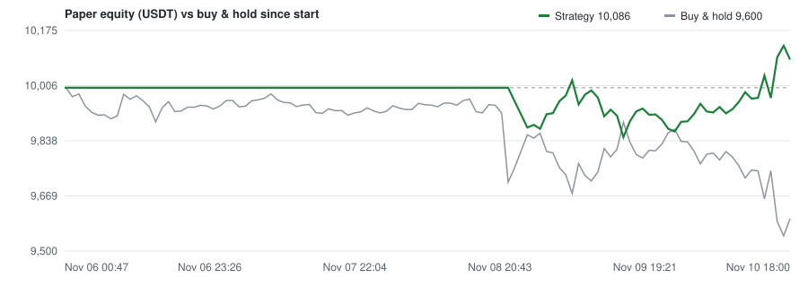

# BTC/USDT paper trading - RUNNING

> **Paper money only. No real orders are placed.** Updated 2026-11-06T18:31:25Z - data source `binance_vision` - run `run-20261106T0047Z`

| Metric | Value |
|---|---|
| Equity | **10,000.00 USDT** (+0.00%) |
| P&L | 0.00 USDT (realised 0.00, unrealised 0.00) |
| Buy & hold since start | -0.66% (strategy vs B&H: +0.66%) |
| BTC price | 75,834.07 (start 76,340.00) |
| Position | flat 0.00000 BTC = 0.00 USDT (0.0% exposure, hybrid) |
| Cash | 10,000.00 USDT |
| Max drawdown | 0.00% (current 0.00%) |
| Fees paid | 0.00 USDT - funding paid 0.00 USDT (negative = received) |
| Trades / round trips | 0 / 0 (win rate n/a) |
| Run window | 2026-11-06T00:47:35Z -> 2026-12-06T00:00:00Z (day 0.7 of 30) |
| Strategy | `lss_breakdown_vol(entry_n=240, exit_n=48, regime_n=3000, floor=0.35, short_risk=0.004)` |

## Recent fills

_No fills yet._

## Events

- `2026-11-06T00:47:35Z` **info** - paper run started: lss_breakdown_vol(entry_n=240, exit_n=48, regime_n=3000, floor=0.35, short_risk=0.004), 10,000.00 USDT, 30 days, data via binance_vision

## Health

- Last tick: 2026-11-06T18:31:25Z (ticks run: 6)
- Last successful tick: 2026-11-06T18:31:25Z
- Last closed bar processed: 2026-11-06T18:00:00Z
- Consecutive failures: 0

Ledgers: [trades.csv](trades.csv) - [trips.csv](trips.csv) - [equity.csv](equity.csv) - [events.jsonl](events.jsonl) - [state.json](state.json)
