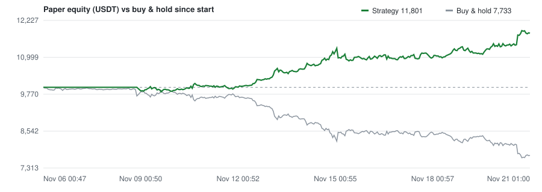

# BTC/USDT paper trading - RUNNING

> **Paper money only. No real orders are placed.** Updated 2026-11-15T07:56:16Z - data source `binance_vision` - run `run-20261106T0047Z`

| Metric | Value |
|---|---|
| Equity | **11,117.27 USDT** (+11.17%) |
| P&L | 1,117.27 USDT (realised 0.00, unrealised 1,109.92) |
| Buy & hold since start | -16.29% (strategy vs B&H: +27.46%) |
| BTC price | 63,906.60 (start 76,340.00) |
| Position | short 0.14027 BTC = 8,964.18 USDT (-80.6% exposure, hybrid) |
| Cash | 20,081.45 USDT |
| Max drawdown | 2.88% (current 1.60%) |
| Fees paid | 5.04 USDT - funding paid -7.34 USDT (negative = received) |
| Trades / round trips | 3 / 0 (win rate n/a) |
| Run window | 2026-11-06T00:47:35Z -> 2026-12-06T00:00:00Z (day 9.3 of 30) |
| Strategy | `lss_breakdown_vol(entry_n=240, exit_n=48, regime_n=3000, floor=0.35, short_risk=0.004)` |

## Recent fills

| Time (UTC) | Side | Qty BTC | Fill price | Notional | Fee | Realised P&L | Reason |
|---|---|---:|---:|---:|---:|---:|---|
| 2026-11-15T02:00:00Z | sell | 0.01899 | 62,606.20 | 1,188.89 | 0.59 | 0.00 | signal |
| 2026-11-13T06:00:00Z | sell | 0.01640 | 68,123.29 | 1,117.22 | 0.56 | 0.00 | signal |
| 2026-11-08T22:00:00Z | sell | 0.10488 | 74,113.53 | 7,773.03 | 3.89 | 0.00 | signal |

## Events

- `2026-11-06T00:47:35Z` **info** - paper run started: lss_breakdown_vol(entry_n=240, exit_n=48, regime_n=3000, floor=0.35, short_risk=0.004), 10,000.00 USDT, 30 days, data via binance_vision

## Health

- Last tick: 2026-11-15T07:56:16Z (ticks run: 40)
- Last successful tick: 2026-11-15T07:56:16Z
- Last closed bar processed: 2026-11-15T07:00:00Z
- Consecutive failures: 0

Ledgers: [trades.csv](trades.csv) - [trips.csv](trips.csv) - [equity.csv](equity.csv) - [events.jsonl](events.jsonl) - [state.json](state.json)
